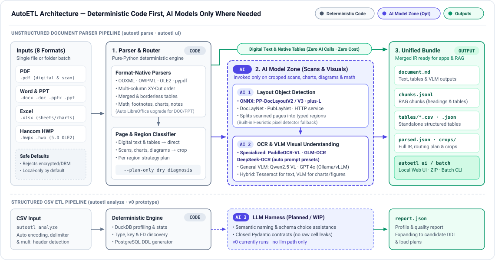

# AutoETL

[](https://github.com/bullbearbull/AutomaticETL/actions/workflows/ci.yml)


[한국어](README.md) · [Parser Details](src/autoetl/parser/README.md) · [Changelog](CHANGELOG.md)

A local document parser and ETL tool that runs in a single Python process.  
Deterministic code extracts digital text and native tables from PDF, Microsoft Office, and Korean Hancom (HWP/HWPX) documents first, and only routes cropped visual regions (scanned pages, charts, diagrams, formulas) to optional AI models (ONNX layout detection + OCR/VLM).

> Status: **`v0.1.0-beta.1`** (installable from Git; not yet on PyPI).
> - **Document parser (`parse`, `ui`, `doctor`)**: ready to use across 8 formats, with RAG chunking, folder batching, a local web UI, and optional ONNX layout / OCR-VLM backends.
> - **Deterministic Structured ETL (`analyze`, `ui`)**: zero-AI (0MB) multi-file CSV/TSV/XLSX analysis — missing values, 10-role column classification, structured string pattern decomposition, cross-table FKs (including hidden string-slot FKs), optimal PK selection, verified PostgreSQL DDL, Mermaid ERD, and topological Load Plan.

---

## Architecture & Where AI Models Run



Instead of sending every page to an expensive VLM, AutoETL runs a format-native parser and structural router first. Digital text and native tables bypass AI completely; **only cropped scans, charts, diagrams, and formulas enter the AI stage**.

### AI Integration Points & Supported Models

| Stage | What it does | Supported models & backends | CLI flags |
| --- | --- | --- | --- |
| **Deterministic Structured ETL** *(0MB AI)* | Multi-file CSV/TSV/XLSX profiling, 10-role column typing, string pattern decomposition, internal/cross-table FKs, PK selection, verified PostgreSQL DDL & topological Load Plan | **No AI model required** (sandboxed DuckDB + `sqlglot` DDL verification + deterministic stats/regex engine) | `autoetl analyze <dir\|files...> --out ./etl_plan` |
| **AI 1 — Layout Object Detection** | Splits scanned PDFs or image slides into typed regions (tables, charts, formulas, text) before OCR/VLM | **ONNX** (`onnxruntime`): `PP-DocLayoutV2`, `PP-DocLayoutV3`, `PP-DocLayout_plus-L`, `DocLayNet`, `PubLayNet`<br>**HTTP**: local/internal layout detection service<br>*(Built-in `heuristic` pixel detector works with zero model files)* | `--layout-detector onnx\|http\|heuristic`<br>`--layout-label-preset` |
| **AI 2 — OCR & VLM Understanding** | Converts cropped scans, charts, diagrams, and equations into Markdown and tables | **Specialized OCR-VLMs** *(auto-detected from model name with built-in task prompts)*: `PaddleOCR-VL` (0.9B), `GLM-OCR` (0.9B), `DeepSeek-OCR` (3B)<br>**General VLMs**: any Vision model on Ollama / vLLM / llama-server / LM Studio (e.g. `Qwen2.5-VL`), or external OpenAI-compatible APIs (`gpt-4o`)<br>**Hybrid**: routes plain text scans to local `Tesseract` and only charts/figures to VLM | `--vision ollama\|openai-compat\|hybrid\|tesseract`<br>`--vision-model`<br>`--vision-prompt-preset auto` |

- Lightweight OCR-VLMs (`PaddleOCR-VL`, `GLM-OCR`, `DeepSeek-OCR`) are detected automatically from `--vision-model`, switching to their official short task triggers (`OCR:`, `Table Recognition:`, etc.) and output cleaners.
- Only loopback (`127.0.0.1`) and registered internal endpoints are allowed by default. Sending crops to an external API requires `--allow-external-vision` and an env var name (`--vision-api-key-env`).

---

## Install

Requires Python 3.10+ on Windows, macOS, or Linux.

```bash
pip install git+https://github.com/bullbearbull/AutomaticETL.git
```

For local development with [uv](https://docs.astral.sh/uv/):

```bash
git clone https://github.com/bullbearbull/AutomaticETL.git
cd AutomaticETL
uv sync
```

---

## Usage

### 1. Multi-table deterministic ETL analysis & DB load planning (0MB AI)

Pass multiple CSV/TSV/XLSX files or a directory to inspect column roles, missingness, structured string decompositions (literal parts vs variable slots), cross-table FKs (including hidden FKs inside string slots), optimal PKs, verified PostgreSQL DDL, and a topological Load Plan:

```bash
autoetl analyze ./sales_data --purpose oltp --out ./etl_plan
autoetl analyze branches.csv customers.csv orders.xlsx --purpose analytics --out ./etl_plan
autoetl analyze ./sales_data --format ddl   # verified PostgreSQL DDL to stdout
autoetl analyze ./sales_data --format erd   # Mermaid ERD to stdout
```

Writing to `--out ./etl_plan` produces 6 files:

```text
etl_plan/
├── ddl.sql              # sqlglot-verified PostgreSQL CREATE TABLE + INDEX statements
├── load_plan.json       # topological load order, UPSERT/WATERMARK/APPEND policies & column transforms
├── relations.json       # internal FDs/correlations/derivations/hierarchies, cross-table FKs & PK scores
├── analysis_bundle.json # complete typed analysis contract JSON
├── erd.mmd              # Mermaid erDiagram
└── analysis_report.md   # full analysis report in Markdown
```

### 2. Parse a single document (default offline mode)

```bash
autoetl parse report.pdf --out ./out
```

This writes a self-contained bundle under `./out`:

```text
out/
├── document.md         # unified Markdown (body, tables, footnotes, formulas, VLM output)
├── chunks.jsonl        # RAG chunks preserving heading paths, pages, and table headers
├── parsed.json         # full structured IR (Pydantic schema)
├── routing_report.md   # per-page/sheet structural diagnosis and routing plan
├── routing_report.json
├── tables/             # extracted tables as .csv and .json
└── crops/              # cropped figures, charts, diagrams, and scan regions
```

You can also stream directly to stdout without writing a directory:

```bash
autoetl parse report.pdf --plan-only       # structural routing plan only
autoetl parse report.pdf --format markdown # Markdown to stdout
autoetl parse report.pdf --format chunks   # JSONL chunks to stdout
```

### 3. Attach AI models for scanned pages & charts

```bash
# Recommended 2-stage local stack: PP-DocLayoutV2 (ONNX) → PaddleOCR-VL-1.6
autoetl parse scanned.pdf \
  --layout-detector onnx --layout-model-path ./models/PP-DocLayoutV2.onnx \
  --vision openai-compat --vision-model PaddleOCR-VL-1.6 \
  --vision-base-url http://127.0.0.1:8080/v1 --out ./out

# Local Ollama GLM-OCR, or hybrid routing (Tesseract for text + Qwen2.5-VL for charts/diagrams)
autoetl parse scanned.pdf --layout-detector heuristic --vision ollama --vision-model glm-ocr --out ./out
autoetl parse deck.pptx --vision hybrid --vision-model qwen2.5vl:7b \
  --vision-base-url http://127.0.0.1:11434/v1 --out ./out

# External OpenAI-compatible API (explicit opt-in required)
autoetl parse report.pdf --vision openai-compat --vision-model gpt-4o \
  --vision-base-url https://api.openai.com/v1 --vision-api-key-env OPENAI_API_KEY \
  --allow-external-vision --out ./out
```

### 4. Batch-parse a folder

Pass a directory to recursively discover and parse all supported files:

```bash
autoetl parse ./docs --out ./batch_out --workers 4 --resume
```

- Corrupt or encrypted files are isolated so the rest of the batch finishes cleanly.
- `--resume` skips files whose SHA-256 already succeeded in a prior run.
- Produces `batch_summary.md`, `batch_manifest.json`, and a merged `all_chunks.jsonl`.

### 5. Local web UI

```bash
autoetl ui
```

Starts a stdlib-only web UI on `http://127.0.0.1:8765` (loopback only by default). Switch between **Document Parser** and **Multi-Table ETL Analysis** to inspect column roles, decomposed string patterns, PK/FK graphs, verified DDL, Mermaid ERD, or parsed document outputs, and download the full bundle as a ZIP.

### 6. Python API

```python
import autoetl

# Multi-table deterministic ETL analysis & DB load plan (0MB AI)
etl = autoetl.analyze_tables(["./sales_data"], purpose="oltp", out_dir="./etl_plan")
print(etl.load_plan.selected_candidate_id, etl.load_plan.ddl_sql)

# Document parsing & chunking
doc = autoetl.parse("notice.hwp")
chunks = autoetl.chunk_document(doc, options=autoetl.ChunkOptions(max_chars=1500))
manifest = autoetl.export_bundle(doc, "./out_hwp")

batch = autoetl.parse_batch("./docs", "./batch_out", workers=4, resume=True)
```

### 7. Environment check

```bash
autoetl doctor
```

Shows all 8 built-in formats and which optional backends (LibreOffice, PDF renderer, ONNX, Tesseract) are available in your environment.

---

## Supported Formats

Aside from `pypdf` for PDFs, all parsers are pure Python using only the standard library.

| Format | Built-in engine | Notes |
| --- | --- | --- |
| `.pdf` | `pypdf` + geometry/table/image extractor | Multi-column reading order, ruled & borderless tables, scan crops |
| `.docx` | Pure-Python OOXML parser | Styles, multi-level lists, track changes, OMML math, tables, footnotes, comments |
| `.pptx` | Pure-Python OOXML parser | Layouts, grouped shapes, tables, charts, embedded Excel, speaker notes |
| `.xlsx` | Streaming OOXML parser | Sheets, merged cells, multi-row headers, date/number formats, comments, charts |
| `.hwpx` | Pure-Python OWPML parser | Outlines, merged grid tables, Hancom equations, headers/footers, footnotes, comments |
| `.hwp` | Pure-Python HWP 5.0 (OLE2) parser | Body text, merged tables, equations, footnotes, BinData images (rejects encrypted/DRM) |
| `.doc`, `.ppt` | Pure-Python OLE2 parser (+ LibreOffice upgrade) | Uses `soffice` automatically when installed; falls back to built-in parser otherwise |

Pass `--include-comments` to include review comments / hidden notes. Encrypted or DRM-protected files are rejected with a clear error rather than bypassed, and logs/errors never include raw document text or cell values.

---

## Structured CSV Analysis (WIP)

The CSV profiling and schema-design pipeline is still at v0 (`--no-llm` only):

```bash
autoetl analyze sample.csv --no-llm --out report.json
```

Statistics, type inference, relation discovery, and PostgreSQL DDL generation are computed deterministically in code, with LLM assistance planned only at fixed decision points.

---

## Development

```bash
uv sync
uv run pytest
uv run ruff check .
uv run ruff format --check .
uv run mypy
uv run python tools/license_check.py
```

CI runs tests, linting, strict `mypy`, and runtime dependency license checks across Windows, macOS, and Linux on Python 3.10–3.13. See [CONTRIBUTING.md](CONTRIBUTING.md) for guidelines.

## License

[Apache-2.0](LICENSE)
