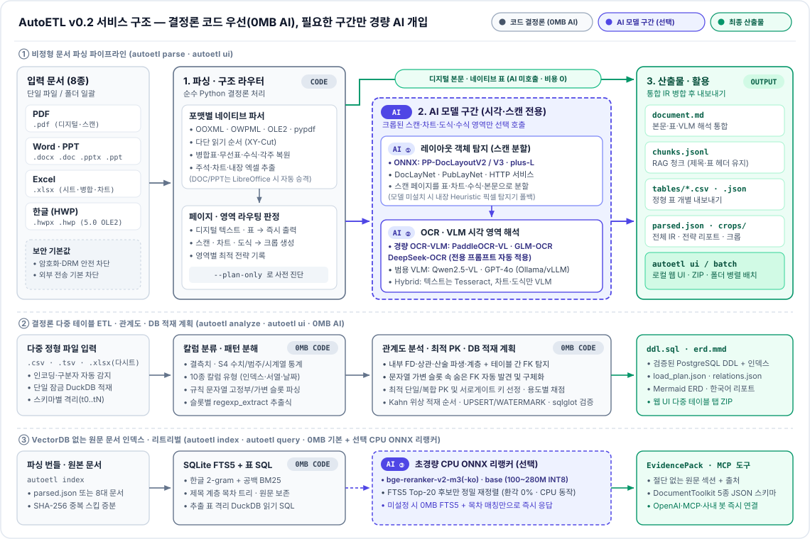

# AutoETL

[](https://github.com/bullbearbull/AutomaticETL/actions/workflows/ci.yml)


[English](README.en.md) · [파서 상세 문서](src/autoetl/parser/README.md) · [변경 이력](CHANGELOG.md)

로컬에서 바로 돌리는 문서 파서 겸 ETL 도구입니다.  
PDF, Office 문서, 한글(HWP/HWPX) 파일에서 코드로 읽을 수 있는 본문·표는 결정론 파서로 즉시 뽑아내고, 스캔 페이지·차트·도식·수식처럼 시각 이해가 필요한 영역만 잘라서 AI 모델(ONNX 레이아웃 탐지 + OCR/VLM)에 넘깁니다.

> 현재 **`v0.2.0-beta.4`** 베타 상태입니다. 아직 PyPI에는 올리지 않았고 Git으로 설치해 쓸 수 있습니다.
> - **문서 파서 (`parse`, `ui`, `doctor`)**: 8개 포맷 파싱, RAG 청킹, 폴더 일괄 처리, 로컬 웹 UI, 선택 레이아웃·OCR/VLM 연동까지 바로 사용 가능
> - **결정론 정형 ETL (`analyze`, `ui`)**: 여러 CSV·TSV·XLSX 파일의 결측치·10종 칼럼 유형 분류·규칙 문자열 내부 분해·테이블 간 FK(숨은 문자열 슬롯 FK 포함)·최적 PK 선정·PostgreSQL DDL·Mermaid ERD·위상 적재 계획(Load Plan)을 **AI/LLM 없이(0MB)** 바로 생성
> - **원문 문서 인덱스·리트리벌 (`index`, `query`)**: VectorDB·생성 LLM 없이 **SQLite FTS5(한글 2-gram) + 목차 트리 + DuckDB 표 SQL**(0MB 기본)과 선택 **초경량 CPU ONNX 리랭커**(100M–280M)로 청크 절단 없는 원문 `EvidencePack` 반환

---

## 동작 구조와 AI 모델 활용



문서 전체를 통째로 VLM에 던지지 않습니다. 먼저 코드 파서가 페이지·시트 구조를 분류해 디지털 텍스트와 네이티브 표를 바로 추출하고, **시각 해석이 필요한 크롭 영역에만 AI 모델을 선택적으로 붙이는 2단계 구조**입니다.

### 어디에 어떤 AI 모델이 쓰이나요?

| 적용 구간 | 역할 | 지원하는 모델 / 백엔드 | CLI 플래그 |
| --- | --- | --- | --- |
| **정형 ETL 결정론 엔진** *(0MB AI)* | 여러 CSV·TSV·XLSX의 결측치·10종 칼럼 유형·규칙 문자열 분해·내부/교차 FK·최적 PK·PII 민감 컬럼 탐지·DuckDB 실제 시험 적재 검증·PostgreSQL DDL(`IDENTITY`·`PARTITION BY`·`COMMENT ON COLUMN`)·위상 적재 계획 생성 | **AI 모델 불필요** (격리 DuckDB 시험 적재 + `sqlglot` 검증 + 결정론 통계·정규식·PII 엔진) | `autoetl analyze <dir\|files...> --out ./etl_plan` |
| **원문 문서 인덱스 + 선택 리랭커** *(0MB 기본)* | VectorDB 없이 SQLite FTS5(한글 2-gram·동의어 확장) + 목차 + DuckDB 표 SQL로 원문 섹션 전체 검색. 필요 시 CPU Cross-Encoder로 Top-20만 정밀 재정렬(생성 모델 없이 원문 그대로 반환) | **기본 0MB**: SQLite FTS5 BM25 + 목차 + DuckDB SQL<br>**선택 CPU ONNX 리랭커**: `jina-reranker-v2-base-multilingual` (INT8 ~280MB), `bge-reranker-v2-m3(-ko)` (INT8 ~280MB), `bge-reranker-base` (~110MB) | `autoetl index <dir> --out ./doc.sqlite [--replace]`<br>`autoetl query ./doc.sqlite "질문" [--synonyms ...] [--reranker onnx ...]` |
| **AI ① 레이아웃 객체 탐지** | 스캔 PDF·이미지 슬라이드를 표·차트·수식·본문 영역으로 자동 분할 크롭 | **ONNX**(`onnxruntime`): `PP-DocLayoutV2`, `PP-DocLayoutV3`, `PP-DocLayout_plus-L`, `DocLayNet`, `PubLayNet`<br>**HTTP**: 로컬/사내 레이아웃 탐지 서버<br>*(모델 없이도 내장 `heuristic` 픽셀 탐지기로 동작)* | `--layout-detector onnx\|http\|heuristic`<br>`--layout-label-preset` |
| **AI ② OCR · VLM 시각 해석** | 크롭된 스캔 영역·차트·도식·수식을 Markdown과 표로 변환 | **경량 문서 특화 OCR-VLM** *(모델명 자동 감지·전용 프롬프트 내장)*: `PaddleOCR-VL` (0.9B), `GLM-OCR` (0.9B), `DeepSeek-OCR` (3B)<br>**범용 VLM**: Ollama / vLLM / llama-server / LM Studio의 `Qwen2.5-VL` 등 모든 Vision 모델, 외부 OpenAI 호환 API (`gpt-4o` 등)<br>**하이브리드**: 단순 텍스트는 로컬 `Tesseract` OCR, 차트·도식만 VLM으로 자동 분배 | `--vision ollama\|openai-compat\|hybrid\|tesseract`<br>`--vision-model`<br>`--vision-prompt-preset auto` |

- `PaddleOCR-VL`, `GLM-OCR`, `DeepSeek-OCR` 같은 경량 문서 특화 모델은 `--vision-model` 이름만 주면 공식 짧은 태스크 프롬프트(`OCR:`, `Table Recognition:` 등)와 출력 정제 규칙이 자동으로 맞춰집니다.
- 로컬(`127.0.0.1`)·사내 등록 서버만 기본 허용되며, 외부 API 엔드포인트로 이미지를 보내려면 `--allow-external-vision`과 API 키 환경변수 이름(`--vision-api-key-env`)을 직접 지정해야 합니다.

---

## 설치

Python 3.10 이상(Windows, macOS, Linux)에서 동작합니다.

```bash
pip install git+https://github.com/bullbearbull/AutomaticETL.git
```

개발 환경으로 받으려면 [uv](https://docs.astral.sh/uv/)를 씁니다.

```bash
git clone https://github.com/bullbearbull/AutomaticETL.git
cd AutomaticETL
uv sync
```

---

## 사용법

### 1. 다중 테이블 결정론 분석 및 DB 적재 계획 생성 (0MB AI)

연관된 CSV·TSV·다중 시트 XLSX 파일 여러 개나 폴더를 넘기면 칼럼 유형·결측치·규칙 문자열 내부 분해(공통 고정부 vs 가변 슬롯)·테이블 간 FK(문자열 슬롯 속 숨은 FK 포함)·최적 PK·검증된 PostgreSQL DDL과 위상 적재 계획을 한 번에 생성합니다.

```bash
autoetl analyze ./sales_data --purpose oltp --out ./etl_plan
autoetl analyze branches.csv customers.csv orders.xlsx --purpose analytics --out ./etl_plan
autoetl analyze ./sales_data --format ddl   # 검증된 PostgreSQL DDL만 stdout 출력
autoetl analyze ./sales_data --format erd   # Mermaid ERD만 stdout 출력

# 실제 DB(SQLite · DuckDB · 선택 PostgreSQL)에 바로 적재 + 디폴트 데이터 관리 테이블 4종 자동 생성
autoetl load ./sales_data --db ./warehouse.sqlite --mask-pii
autoetl load ./sales_data --db ./analytics.duckdb --engine duckdb --purpose analytics
autoetl catalog ./warehouse.sqlite                     # 배치 시점·데이터 고유 ID·데이터 종류·격리함 조회
autoetl catalog ./warehouse.sqlite --rollback <batch_id> # 잘못 올린 배치 역순 안전 롤백
```

`--out ./etl_plan` 폴더에는 아래 6개 파일이 생성됩니다.

```text
etl_plan/
├── ddl.sql              # sqlglot 재파싱 검증을 통과한 PostgreSQL CREATE TABLE + INDEX
├── load_plan.json       # 위상 적재 순서·증분(UPSERT/WATERMARK/APPEND)·컬럼 변환·추출식
├── relations.json       # 테이블 내부 관계(FD/상관/파생/계층) + 테이블 간 FK + 최적 PK 근거
├── analysis_bundle.json # E1~E4 전체 분석 계약 JSON
├── erd.mmd              # Mermaid erDiagram
└── analysis_report.md   # 칼럼 분류·결측치·문자열 패턴 분해·적재 계획 한국어 리포트
```

`autoetl load` 또는 웹 UI의 **DB로 저장하기**로 적재하면 업무 테이블(행마다 `_etl_batch_id`, `_etl_dataset_id`, `_etl_loaded_at` 이력 포함)과 함께 디폴트 관리 테이블 4종(`_etl_load_batches`, `_etl_datasets`, `_etl_column_registry`, `_etl_quarantine_rows`)이 자동으로 생성되어 저장 시점·고유 ID·데이터 종류·컬럼 사전·오류 격리함을 추적할 수 있습니다.

### 2. 문서 파일 하나 파싱하기 (기본 오프라인 모드)

```bash
autoetl parse report.pdf --out ./out
```

실행하면 아래 결과물이 `./out` 폴더에 쌓입니다.

```text
out/
├── document.md         # 본문·표·각주·수식·VLM 해석을 합친 Markdown
├── chunks.jsonl        # 제목 경로·페이지·표 헤더를 유지한 RAG 청크
├── parsed.json         # 전체 구조 IR (Pydantic 스키마)
├── routing_report.md   # 페이지·시트별 구조 판정과 파싱 전략 리포트
├── routing_report.json
├── tables/             # 추출된 표별 .csv / .json
└── crops/              # 스캔·그림·도식 영역 이미지 크롭
```

출력 파일 없이 터미널에서 바로 파이프로 넘길 수도 있습니다.

```bash
autoetl parse report.pdf --plan-only       # 구조 진단 리포트만 확인
autoetl parse report.pdf --format markdown # Markdown을 stdout으로 출력
autoetl parse report.pdf --format chunks   # RAG 청크(JSONL)를 stdout으로 출력
```

### 3. 스캔 문서·차트에 AI 모델 연결하기

```bash
# 권장 2단계 로컬 구성: PP-DocLayoutV2(ONNX)로 영역 분할 → PaddleOCR-VL-1.6으로 영역별 해석
autoetl parse scanned.pdf \
  --layout-detector onnx --layout-model-path ./models/PP-DocLayoutV2.onnx \
  --vision openai-compat --vision-model PaddleOCR-VL-1.6 \
  --vision-base-url http://127.0.0.1:8080/v1 --out ./out

# Ollama 로컬 GLM-OCR 또는 Qwen2.5-VL 하이브리드(텍스트=Tesseract, 차트/도식=VLM)
autoetl parse scanned.pdf --layout-detector heuristic --vision ollama --vision-model glm-ocr --out ./out
autoetl parse deck.pptx --vision hybrid --vision-model qwen2.5vl:7b \
  --vision-base-url http://127.0.0.1:11434/v1 --out ./out

# 외부 OpenAI 호환 API 사용 시 명시적 허용 필요
autoetl parse report.pdf --vision openai-compat --vision-model gpt-4o \
  --vision-base-url https://api.openai.com/v1 --vision-api-key-env OPENAI_API_KEY \
  --allow-external-vision --out ./out
```

### 4. 문서 폴더 통째로 처리하기

입력 경로에 폴더를 넘기면 지원되는 문서를 재귀적으로 찾아 일괄 처리합니다.

```bash
autoetl parse ./docs --out ./batch_out --workers 4 --resume
```

- 문서 하나가 깨지거나 암호화되어 있어도 나머지 파일은 계속 진행합니다.
- `--resume`을 켜면 SHA-256 기준으로 이미 끝난 파일은 건너뜁니다.
- 끝나면 요약 리포트(`batch_summary.md`), 실행 기록(`batch_manifest.json`), 전체 문서 청크를 합친 `all_chunks.jsonl`이 함께 만들어집니다.

### 5. 브라우저에서 바로 써보기

```bash
autoetl ui
```

별도 프런트엔드 빌드나 외부 서버 없이 `http://127.0.0.1:8765`에 로컬 웹 UI가 뜹니다.  
**문서 글·표 추출**, **엑셀·CSV 구조 분석**, **문서 내용 검색** 3개 탭에서 파일을 끌어다 놓기만 하면 본문·표 추출, 표 관계·개인정보·DB 설계, 원문·표 검색까지 바로 실행하고 ZIP 또는 `.sqlite` 파일로 저장할 수 있으며, 세부 설정은 필요할 때만 펼쳐 조정할 수 있습니다. 기본적으로 내 PC(`127.0.0.1`)에서만 열립니다.

### 6. VectorDB 없이 원문 문서 색인·검색하기 (0MB 기본 + 선택 CPU ONNX 리랭커)

파싱 번들(`parsed.json`)이나 원본 문서 폴더를 단일 SQLite 파일(`FTS5` 한글 2-gram + 목차 트리 + 추출 표)로 색인해 청크 절단 없는 원문 섹션 전체(`EvidencePack`)를 바로 꺼내 쓸 수 있습니다.

```bash
# 0MB 기본 모드: SQLite FTS5(한글 2-gram) + 목차 트리 + DuckDB 표 SQL
autoetl index ./docs --out ./doc_index.sqlite
autoetl query ./doc_index.sqlite "개인정보 암호화 보관 기간"

# 선택 초경량 CPU ONNX Cross-Encoder 리랭커(280MB INT8, 생성 모델 없이 원문 그대로 반환)
autoetl query ./doc_index.sqlite "개인정보 암호화 보관 기간" \
  --reranker onnx --reranker-model ./models/jina_v2_int8/onnx/model_int8.onnx --format json
```

### 7. Python에서 불러 쓰기

```python
import autoetl

# 다중 테이블 결정론 분석 & DB 적재 계획 (0MB AI)
etl = autoetl.analyze_tables(["./sales_data"], purpose="oltp", out_dir="./etl_plan")
print(etl.load_plan.selected_candidate_id, etl.load_plan.ddl_sql)

# VectorDB 없는 원문 문서 인덱스 & 에이전트/MCP 도구 5종
autoetl.build_document_index("./docs", "./doc_index.sqlite")
with autoetl.DocumentToolkit("./doc_index.sqlite") as kit:
    evidence = kit.search_documents("개인정보 암호화 보관", top_k=5)
    tools_schema = kit.tool_schemas()  # OpenAI / MCP / 사내 봇에 그대로 연결

# 문서 파싱 & 청킹
doc = autoetl.parse("notice.hwp")
chunks = autoetl.chunk_document(doc, options=autoetl.ChunkOptions(max_chars=1500))
manifest = autoetl.export_bundle(doc, "./out_hwp")

# 폴더 일괄 처리
batch = autoetl.parse_batch("./docs", "./batch_out", workers=4, resume=True)
```

### 8. 환경 점검

```bash
autoetl doctor
```

현재 설치된 Python 환경에서 8개 기본 포맷과 선택 백엔드(LibreOffice, PDF 렌더러, ONNX, Tesseract) 중 무엇을 쓸 수 있는지 표로 보여줍니다.

---

## 지원 포맷

핵심 파서 포맷 중 PDF는 `pypdf`, 한글(`.hwp` · `.hwpx`)은 [rhwp](https://github.com/edwardkim/rhwp) Rust 코어의 Python 바인딩인 [`rhwp-python`](https://github.com/DanMeon/rhwp-python)(MIT 라이선스, 파싱·네이티브 PNG 렌더링)을 사용하며, 나머지 OOXML/OLE2 포맷은 Python 표준 라이브러리로 구현했습니다. 자세한 제3자 오픈소스 고지는 [THIRD_PARTY_NOTICES.md](THIRD_PARTY_NOTICES.md)를 참고해 주세요.

| 포맷 | 기본 처리 방식 | 참고 |
| --- | --- | --- |
| `.pdf` | `pypdf` + 자체 기하/표/이미지 추출기 | 다단 읽기 순서, 격자·무선 표, 스캔 페이지 크롭 |
| `.docx` | 내장 OOXML 파서 | 스타일·다단계 번호·변경추적·수식(OMML)·표·각주·주석 |
| `.pptx` | 내장 OOXML 파서 | 슬라이드 레이아웃·그룹 도형·표·차트·내장 엑셀·발표자 노트 |
| `.xlsx` | 내장 OOXML 스트리밍 파서 | 시트별 표·병합 셀·다단 헤더·날짜/숫자 서식·주석·차트 |
| `.hwpx` | **`rhwp` (`rhwp-python`, MIT)** + 레이아웃/VLM 어댑터 | Rust 코어 IR·병합 표·수식·각주·미주·머리글/바닥글·네이티브 PNG 렌더링 |
| `.hwp` | **`rhwp` (`rhwp-python`, MIT)** + CFB 보안 가드 | HWP 5.0 본문·병합 표·수식·각주·`BinData`·네이티브 PNG 렌더링 (암호화·DRM·배포용 차단) |
| `.doc`, `.ppt` | 내장 OLE2 파서 (+ LibreOffice 자동 승격) | `soffice`가 PATH에 있으면 고충실도 변환, 없으면 내장 파서로 폴백 |

주석·숨은설명이 필요하면 `--include-comments`를 붙이면 됩니다.  
암호화되거나 DRM·배포용 제한이 걸린 문서는 우회하지 않고 오류 메시지로 알려주며, 로그와 오류 메시지에는 문서 본문이나 셀 값을 남기지 않습니다.

---

## 개발

```bash
uv sync
uv run pytest
uv run ruff check .
uv run ruff format --check .
uv run mypy
uv run python tools/license_check.py
```

CI는 Windows, macOS, Linux × Python 3.10~3.13에서 테스트, 린트, strict mypy, 런타임 의존성 라이선스 검사를 돌립니다.  
기여 방법은 [CONTRIBUTING.md](CONTRIBUTING.md)를 참고해 주세요.

## 라이선스

[Apache-2.0](LICENSE) · [서드파티 오픈소스 고지 (`THIRD_PARTY_NOTICES.md`)](THIRD_PARTY_NOTICES.md)
